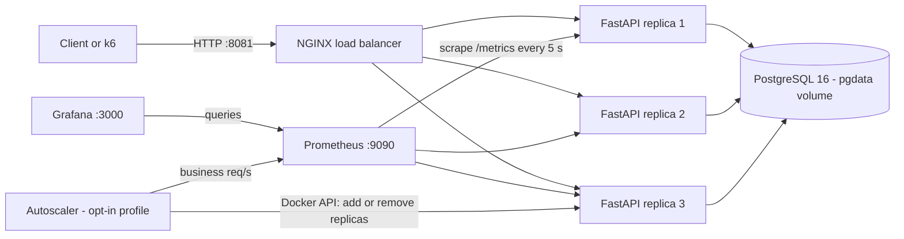
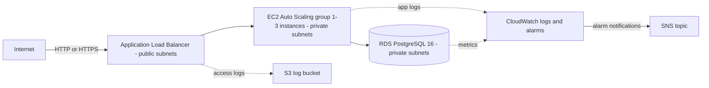
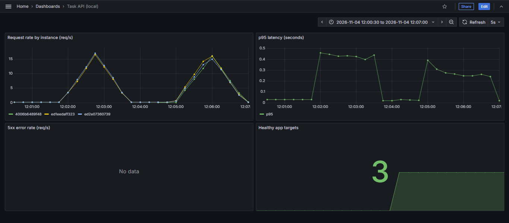
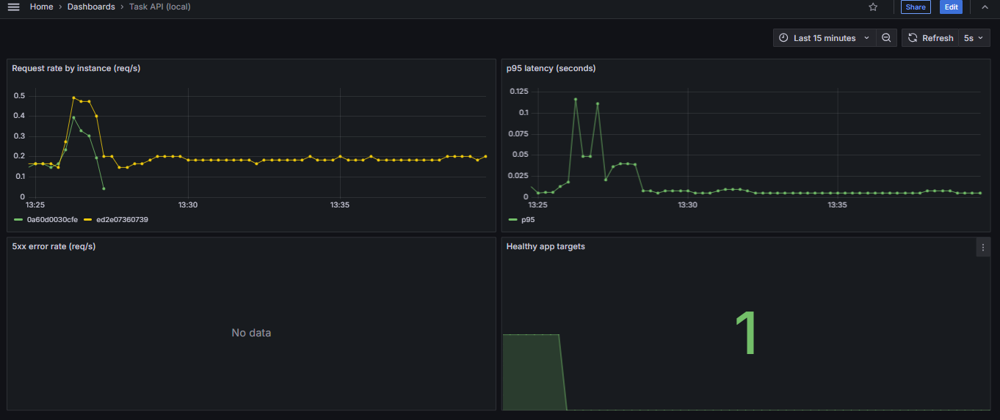
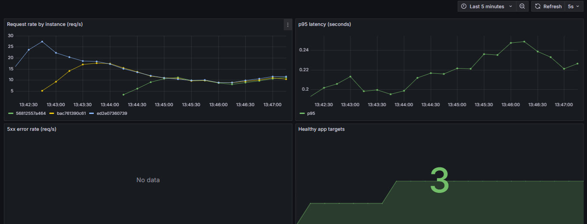
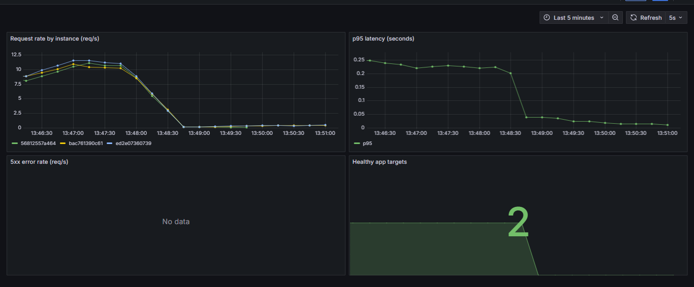

# Terraform AWS DevOps Platform


A local-first DevOps and platform engineering portfolio project. A small FastAPI + PostgreSQL
service runs behind NGINX on Docker Compose, is monitored with Prometheus and Grafana, is
load-tested with k6, and is scaled automatically by a custom Python autoscaling controller.
The same platform is designed for AWS as modular Terraform, which is **formatted, validated and
security-scanned but never deployed**. A GitHub Actions pipeline runs all checks.

> **AWS infrastructure in this repository is design and validation only.** No AWS resource has
> been created. `terraform plan`, `apply` and `destroy` are never run, and no AWS credentials are
> used anywhere in the project. Everything that *runs* runs locally on Docker.

---

## Contents

1. [Problem and objectives](#problem-and-objectives)
2. [Key features](#key-features)
3. [Architecture](#architecture)
4. [Technology stack](#technology-stack)
5. [Repository structure](#repository-structure)
6. [Prerequisites](#prerequisites)
7. [Setup and startup](#setup-and-startup)
8. [Service URLs and ports](#service-urls-and-ports)
9. [API overview](#api-overview)
10. [Docker and NGINX](#docker-and-nginx)
11. [Monitoring with Prometheus and Grafana](#monitoring-with-prometheus-and-grafana)
12. [Load testing with k6](#load-testing-with-k6)
13. [Local autoscaling controller](#local-autoscaling-controller)
14. [Terraform AWS design](#terraform-aws-design)
15. [AWS deployment status](#aws-deployment-status)
16. [CI pipeline (GitHub Actions)](#ci-pipeline-github-actions)
17. [Security practices and limitations](#security-practices-and-limitations)
18. [Evidence](#evidence)
19. [Learning outcomes and interview talking points](#learning-outcomes-and-interview-talking-points)

---

## Problem and objectives

Cloud labs cost money, and a portfolio project that only shows code says little about how a
service is operated. This project demonstrates the full delivery lifecycle **on a single laptop
with zero cloud spend**:

- build and containerise a small API with a real database,
- run several replicas behind a load balancer,
- observe them with metrics and dashboards,
- measure them under load,
- scale them automatically and safely,
- describe the equivalent cloud infrastructure as code and validate it statically,
- and automate all checks in CI.

Every result quoted below comes from the evidence files in [`docs/evidence/`](docs/evidence/).

## Key features

| Area | What was built | Status |
|---|---|---|
| Application | FastAPI task API (CRUD) with PostgreSQL, health/readiness endpoints, Prometheus metrics, `X-Instance-ID` header | Verified locally |
| Containers | Docker Compose: PostgreSQL with a persistent volume, scalable app service, healthchecks | Verified locally |
| Load balancing | NGINX discovering app replicas through Docker DNS, with retry on failed upstreams | Verified locally |
| Observability | Prometheus service discovery of replicas, provisioned Grafana dashboard | Verified locally |
| Load testing | k6 scenario (create → read → delete) with latency and error thresholds | Measured (M6, M7) |
| Autoscaling | Python controller scaling app replicas 1–3 through the Docker API, driven by Prometheus | Live-validated (M7) |
| Infrastructure as Code | Five Terraform modules for an AWS design (VPC, ALB, Auto Scaling, RDS, CloudWatch, S3) | **Validation only — not deployed** |
| CI | GitHub Actions: tests, image builds, Terraform validate/lint, Checkov | Verified locally; **first GitHub run was sucessfull** |

## Architecture

### Local platform (runs on Docker Compose)



Replicas register under the Docker DNS name `app`; NGINX and Prometheus both discover them through
that name, so replicas added by `docker compose --scale` or by the autoscaler are picked up
automatically.

### AWS design (Terraform, validated — not deployed)



| Local component | AWS equivalent in the Terraform design |
|---|---|
| Docker network | VPC with public and private subnets in two availability zones |
| NGINX on port 8081 | Application Load Balancer |
| App replicas (`--scale`) | EC2 instances in an Auto Scaling group |
| Autoscaler rule: scale out above 10 req/s per replica | Target tracking on `ALBRequestCountPerTarget` = 600 requests/min per instance |
| PostgreSQL container + `pgdata` volume | RDS PostgreSQL with automated backups |
| Prometheus + Grafana | CloudWatch metrics, log groups and alarms |
| NGINX access log | ALB access logs in S3 |

## Technology stack

| Layer | Tools (versions as used and pinned in the project) |
|---|---|
| Application | Python 3.11, FastAPI, SQLAlchemy, Uvicorn, `prometheus-client` |
| Data | PostgreSQL 16 (`postgres:16-alpine`) |
| Containers | Docker, Docker Compose |
| Load balancing | NGINX 1.27 (`nginx:1.27-alpine`) |
| Monitoring | Prometheus v2.55.1, Grafana 11.3.0 |
| Load testing | Grafana k6 v2.3.0 (run as a container) |
| Autoscaling | Python controller using the Docker SDK (`docker>=7.1,<8`) and the Prometheus HTTP API |
| Infrastructure as Code | Terraform 1.16.6, AWS provider 6.71.0 (locked in `.terraform.lock.hcl`) |
| Static analysis | TFLint 0.64.0 with AWS ruleset 0.49.0, Checkov 3.3.29, actionlint 1.7.12 |
| CI | GitHub Actions |
| Tests | pytest — 134 tests (4 API tests, 130 autoscaler tests) |

## Repository structure

```text
.
├── app/                    FastAPI application, Dockerfile and API tests
├── autoscaler/             Autoscaling controller (decision logic, Prometheus client,
│                           Docker scaler, main loop), Dockerfile and unit tests
├── docker/
│   ├── nginx/              NGINX load-balancer configuration
│   ├── prometheus/         Prometheus scrape configuration
│   └── grafana/            Provisioned datasource and dashboard
├── load-tests/             k6 scenario (baseline.js)
├── terraform/
│   ├── modules/            networking, security, compute, database, monitoring
│   └── environments/dev/   Root configuration wiring the modules together
├── .github/workflows/      CI pipeline (ci.yml)
├── docs/evidence/          Test outputs, logs, screenshots and milestone reports (M6–M9)
├── docker-compose.yml      Local platform definition
├── .env.example            Placeholder environment values (copy to .env)
└── pytest.ini              Lets `python -m pytest` run from the repository root
```

## Prerequisites

- Windows with PowerShell (commands below are PowerShell; they also work in other shells with
  minor changes)
- Docker Desktop
- Python 3.11 (only for running the tests outside containers)

Terraform, TFLint, Checkov and k6 do not need to be installed: they run as pinned Docker images.

## Setup and startup

Run from the repository root.

```powershell
# 1. Create a local environment file and replace the placeholder passwords
Copy-Item .env.example .env

# 2. Build and start the platform with two app replicas
docker compose up -d --build --scale app=2

# 3. Check that everything is healthy
docker compose ps
Invoke-WebRequest http://localhost:8081/health -UseBasicParsing
```

Run the test suite:

```powershell
python -m venv .venv
.\.venv\Scripts\Activate.ps1
python -m pip install -r app/requirements.txt
python -m pytest
```

Stop the platform while **keeping** the database:

```powershell
docker compose down
```

> **Never run `docker compose down -v`** unless you intend to delete all data: `-v` removes the
> `pgdata` volume.

## Service URLs and ports

| Service | URL | Notes |
|---|---|---|
| API through NGINX | http://localhost:8081 | The only public entry point to the app |
| Prometheus | http://localhost:9090 | Targets page shows one target per app replica |
| Grafana | http://localhost:3000 | Dashboard "Task API (local)"; admin password from `.env` |
| App replicas | port 8000 | Internal to the Docker network only |
| PostgreSQL | port 5432 | Internal to the Docker network only |

## API overview

| Method | Path | Purpose |
|---|---|---|
| GET | `/health` | Liveness: the process is running (no database access) |
| GET | `/ready` | Readiness: the app can reach PostgreSQL (`503` if not) |
| GET | `/metrics` | Prometheus metrics: `app_http_requests_total`, `app_http_request_duration_seconds` |
| POST | `/tasks` | Create a task (`201`) |
| GET | `/tasks` | List tasks |
| GET | `/tasks/{task_id}` | Read one task (`404` if missing) |
| PUT | `/tasks/{task_id}` | Update a task |
| DELETE | `/tasks/{task_id}` | Delete a task (`204`) |

Every response carries an `X-Instance-ID` header naming the replica that served it, which makes
load balancing visible from the client side.

## Docker and NGINX

- **App service:** built from [`app/Dockerfile`](app/Dockerfile) (Python 3.11 slim, runs as a
  non-root user). It has no published port and a Compose healthcheck on `/ready`, so a replica is
  only healthy when it can reach the database. It scales with `--scale app=N`.
- **PostgreSQL:** data lives in the named volume `pgdata`, so it survives container restarts.
- **NGINX** ([`docker/nginx/default.conf`](docker/nginx/default.conf)) resolves `app` through
  Docker's DNS every 5 seconds (`resolver 127.0.0.11 valid=5s` with a variable `proxy_pass`), so
  new or removed replicas are picked up without restarting NGINX. If a replica fails, the request
  is retried on another one (`proxy_next_upstream error timeout http_502 http_503`, up to 3 tries).

## Monitoring with Prometheus and Grafana

- **Prometheus** ([`docker/prometheus/prometheus.yml`](docker/prometheus/prometheus.yml))
  discovers every replica via `dns_sd_configs` on `app:8000` and scrapes `/metrics` every
  5 seconds.
- **Grafana** is provisioned automatically with a Prometheus datasource and the
  [Task API dashboard](docker/grafana/dashboards/task-api.json): request rate by instance,
  p95 latency, 5xx error rate, and healthy app targets.



## Load testing with k6

The scenario [`load-tests/baseline.js`](load-tests/baseline.js) makes each virtual user create,
read and delete a task in a loop (with a 0.2 s pause), checking `201`, `200` and `204`. Thresholds:
fewer than 1% failed requests and p95 latency below 500 ms. Because every created task is deleted,
the database returns to its original row count after a run.

```powershell
docker run --rm -v "${PWD}\load-tests:/scripts:ro" grafana/k6:latest run -e VUS=10 -e DURATION=60s /scripts/baseline.js
```

### M6 results: 2 replicas vs 3 replicas (10 VUs, 60 s each)

| Metric | 2 replicas | 3 replicas |
|---|---|---|
| Iterations | 675 | 969 |
| HTTP requests | 2025 | 2907 |
| Failed requests | 0.00% (0 of 2025) | 0.00% (0 of 2907) |
| Average response time | 227.8 ms | 138.81 ms |
| p95 response time | 477.86 ms | 343.26 ms |
| Thresholds | passed (p95 close to the limit) | passed |

Source: raw outputs [run-2-replicas.txt](docs/evidence/m6/run-2-replicas.txt) and
[run-3-replicas.txt](docs/evidence/m6/run-3-replicas.txt); analysis in
[comparison.md](docs/evidence/m6/comparison.md).

**How to read this:** in this single pair of runs, 3 replicas had lower latency and completed
more iterations. This is **one run per configuration**, the order was not varied (3 replicas always
ran second), and k6, NGINX, the replicas and PostgreSQL all shared one 4-vCPU laptop. Measured
app CPU was about 1.1 cores in both runs, so the cause of the difference is not established. It is
a measurement, not a general rule that more replicas are faster.

## Local autoscaling controller

The controller in [`autoscaler/`](autoscaler/) is a reconcile loop that runs every 10 seconds:

1. It counts the app replicas in Docker (the source of truth for the replica count).
2. It reads business traffic from Prometheus (requests per second, excluding `/health` and
   `/ready`).
3. A pure, unit-tested decision function chooses *scale out*, *scale in* or *hold*.
4. It adds a replica by copying a healthy one (same image, configuration, labels and network
   alias) and waits for it to become healthy, or removes the highest-numbered replica with a
   graceful stop.

### Policy

| Setting | Value |
|---|---|
| Replicas | minimum 1, maximum 3, one step at a time |
| Scale out | more than 10 req/s per replica for 3 consecutive checks |
| Scale in | less than 4 req/s per replica for 6 consecutive checks, and only if the load spread over one fewer replica stays below 7 req/s |
| Cooldowns | 60 s after a scale-out, 90 s after a scale-in; directional, and started only after a successful action |
| Failures | no cooldown; exponential backoff 10 → 20 → 40 → 60 s |
| Safety | holds when metrics are unavailable or no replica is healthy (never creates containers from guessed configuration); skips when the replica count changed manually; dry-run mode by default |

Start it (it is opt-in and does not start with the rest of the platform):

```powershell
# Dry run (default): logs decisions, changes nothing
docker compose --profile autoscale up -d --build --no-deps autoscaler

# Live scaling
$env:AUTOSCALER_DRY_RUN = "false"; docker compose --profile autoscale up -d --no-deps autoscaler

# Stop
docker compose --profile autoscale stop autoscaler
```

Always name the service and use `--no-deps`; otherwise Compose also resets the `app` service to
one replica.

### Observed live results (M7)

**Run 2 — 5 VUs, 6 minutes: full cycle 1 → 2 → 3 → 2 → 1**

| Time (UTC) | Event |
|---|---|
| 08:12:24 | Scale out 1 → 2 (new replica healthy 7 s after creation) |
| 08:13:53 | Scale out 2 → 3 (after the 60 s cooldown and 3 fresh high checks) |
| 08:13:55–08:17:45 | Held at the maximum of 3; no fourth replica attempted |
| 08:18:56 | Scale in 3 → 2 (highest-numbered replica stopped and removed) |
| 08:21:28 | Scale in 2 → 1; afterwards held at the minimum of 1 |

- k6: **11,460 requests, 0 failed**, p95 244.17 ms, 3820 iterations — all thresholds passed.
- NGINX distributed traffic evenly across 3 replicas (1173 / 1165 / 1121 requests in the
  measured window) and sent no requests to removed replicas. **0 HTTP 5xx** during the run.
- A read-only probe during scale-in: **121 of 121 requests returned `200`**, covering 2 → 1.
- The database returned to 0 rows; every task created by the test was deleted.

**Run 1 — 10 VUs: stopped and recorded as an incident.** Under this heavier load the single
replica's healthcheck timed out while it was still serving traffic, the first new replica was marked
unhealthy and removed, and the run was stopped after 2 min 13 s: 3577 requests, **2 failed with
HTTP 502**, p95 606.99 ms. The controller's safety rules held (failed replica cleaned up, no
cooldown, backoff, hold when no replica was healthy). Runs 1 and 2 used different loads and are
not a performance comparison.

Full timeline, root-cause analysis (evidence separated from hypotheses) and safety verification:
[live-scaling-report.md](docs/evidence/m7/live-scaling-report.md).

| Baseline (1 replica) | Scale-out to 3 | Scale-in to 2 |
|---|---|---|
|  |  |  |

## Terraform AWS design

Five modules under [`terraform/modules/`](terraform/modules/), wired together in
[`terraform/environments/dev/`](terraform/environments/dev/):

| Module | Resources |
|---|---|
| `networking` | VPC, two public and two private subnets across two availability zones, internet gateway, route tables, optional NAT gateway (off by default), locked-down default security group, VPC flow logs to CloudWatch |
| `security` | Security groups chained by reference (internet → ALB → app on 8000 → database on 5432), no SSH; EC2 IAM role with SSM and CloudWatch agent policies |
| `compute` | Application Load Balancer with access logs, target group with `/ready` health check, HTTP listener (HTTPS with redirect when a certificate is provided), launch template (Amazon Linux 2023, IMDSv2 with hop limit 1, encrypted disk), Auto Scaling group 1–3, target-tracking scaling policy |
| `database` | RDS PostgreSQL 16 in private subnets: encrypted, not publicly accessible, TLS enforced, master password generated and stored by AWS (never in code or state), 7-day backups, deletion protection |
| `monitoring` | S3 bucket for ALB logs (public access blocked, encrypted, versioned, TLS-only, lifecycle expiry), application log group, encrypted SNS topic, six CloudWatch alarms (5xx, unhealthy targets, p95 latency, database CPU and storage) |

Design choices: variables carry descriptions, types and validation rules; there are no hard-coded
credentials, account IDs or provisioners; cost-aware defaults (no NAT gateway, single-AZ database,
small instance classes) keep the design cheap *if* it were ever deployed. Details:
[terraform/README.md](terraform/README.md) and the [M8 report](docs/evidence/m8/m8-report.md).

Validate it locally (only `terraform/` is mounted; no credentials are passed):

```powershell
$tf = "hashicorp/terraform:1.16.6"
docker run --rm -v "${PWD}\terraform:/work" -w /work $tf fmt -check -recursive
docker run --rm -v "${PWD}\terraform:/work" -w /work/environments/dev $tf init -backend=false
docker run --rm -v "${PWD}\terraform:/work" -w /work/environments/dev $tf validate
```

### Static analysis results (M8, final run)

| Check | Result |
|---|---|
| `terraform fmt -check` | Passed |
| `terraform validate` | `Success! The configuration is valid.` |
| TFLint (recommended preset + AWS ruleset) | 0 issues |
| Checkov | **174 passed, 0 failed, 20 skipped**, exit code 0 |

The first Checkov run reported 21 failed checks. One was a real weakness and was fixed (the
instance metadata hop limit was lowered from 2 to 1). The other 20 are skipped **inline with a
written reason** next to the resource: 3 verified false positives and 17 accepted cost or design
trade-offs (for example no WAF, single-AZ database, and HTTP only because there is no domain or
certificate). See the disposition table in the [M8 report](docs/evidence/m8/m8-report.md).

## AWS deployment status

**Not deployed.** The Terraform code describes how this platform would run on AWS and is checked
with formatting, validation, linting and security scanning only. No AWS account, credentials,
backend or state file is involved; `terraform plan`, `apply` and `destroy` have never been run.
Runtime behaviour on AWS (boot script, health checks, scaling) is therefore designed but not
proven.

## CI pipeline (GitHub Actions)

The workflow [`.github/workflows/ci.yml`](.github/workflows/ci.yml) runs on pushes and pull
requests to `main` (and manually), as four parallel jobs:

| Job | Steps |
|---|---|
| `python-tests` | Python 3.11 with pip caching → install `app/requirements.txt` → `python -m pytest` |
| `docker-build` | Validate the Compose file (with `.env.example` placeholders) → build the app and autoscaler images (nothing is pushed) |
| `terraform-validate` | `fmt -check` → `init -backend=false -lockfile=readonly` → `validate` → TFLint |
| `terraform-security` | Checkov; the job fails on any failed check |

Workflow security: read-only `contents` permission, no repository secrets, no AWS
authentication, actions pinned to verified commit SHAs, tool images pinned to verified digests,
and the built-in read-only token exposed to a single step (TFLint plugin download).

**Status:** every job was reproduced locally on a fresh copy of the repository and the workflow
passed `actionlint` with 0 errors ([M9 report](docs/evidence/m9/m9-report.md)).

**CI Status:** The first GitHub Actions CI run completed successfully. All four jobs passed: Python tests, Docker build, Terraform validate and lint, and Terraform security scan.


## Security practices and limitations

### Practices

- Secrets stay out of the repository: `.env`, key and certificate files, Terraform state, plans
  and variable files are git-ignored; `.env.example` contains placeholders only.
- PostgreSQL and the app replicas are not exposed to the host; only NGINX, Prometheus and
  Grafana publish ports.
- The app container runs as a non-root user.
- The autoscaler is opt-in, defaults to dry run, runs with a read-only filesystem, all Linux
  capabilities dropped and `no-new-privileges`, publishes no ports, only touches containers with
  this project's `app` labels, and never logs environment variables.
- Terraform: least-privilege security groups, no SSH, IMDSv2, encryption at rest, AWS-managed
  database password, Checkov in CI.
- CI: least-privilege permissions and pinned dependencies (see above).

### Known limitations

- **Docker socket access:** the autoscaler needs the Docker socket, which effectively grants
  control of the Docker host. Acceptable for a local, opt-in demo; on AWS the same job is done by
  an Auto Scaling group with IAM permissions instead.
- **Open findings from M7:** the app healthcheck can time out under heavy load; new replicas receive
  NGINX traffic before they are healthy; the controller cannot scale out if the only replica fails
  its healthcheck; stopping the controller during a scale-out is not graceful.
- **Measurements:** all load tests are single runs on one shared laptop; results are observations,
  not statistically established conclusions.
- **AWS design:** not deployed; private instances would need a NAT gateway or VPC endpoints to
  download packages; there is no remote state backend by design.
- **CI:** Python dependencies use version ranges, so CI may install newer packages than the local
  environment; base images in the Dockerfiles are pinned by tag, not digest.
- An intentionally fake database URL in the autoscaler tests (used to prove secrets never reach the
  logs) may be reported by secret scanners as a false positive.

## Evidence

| Milestone | Report | Raw evidence |
|---|---|---|
| M6 — Load testing | [comparison.md](docs/evidence/m6/comparison.md) | [2-replica run](docs/evidence/m6/run-2-replicas.txt), [3-replica run](docs/evidence/m6/run-3-replicas.txt), [dashboard screenshot](docs/evidence/m6/grafana-dashboard.png) |
| M7 — Live autoscaling | [live-scaling-report.md](docs/evidence/m7/live-scaling-report.md) | [Run 2 k6](docs/evidence/m7/k6-run2-5vu.txt), [Run 2 controller log](docs/evidence/m7/autoscaler-run2-5vu.log), [scale-in probe](docs/evidence/m7/probe-scale-in.txt), [Run 1 k6](docs/evidence/m7/k6-scale-out.txt), [Run 1 controller log](docs/evidence/m7/autoscaler-run1-10vu.log), screenshots [01](docs/evidence/m7/01-baseline.png) · [03](docs/evidence/m7/03-scale-out-2-to-3.png) · [04](docs/evidence/m7/04-scale-in-3-to-2.png) |
| M8 — Terraform validation | [m8-report.md](docs/evidence/m8/m8-report.md) | [validate](docs/evidence/m8/07-validate-final.txt), [TFLint](docs/evidence/m8/08-tflint-final.txt), [Checkov results](docs/evidence/m8/checkov-final/results_cli.txt) |
| M9 — CI | [m9-report.md](docs/evidence/m9/m9-report.md) | [actionlint](docs/evidence/m9/01-actionlint.txt), [pytest](docs/evidence/m9/02-pytest.txt), [Terraform](docs/evidence/m9/05-terraform-validate.txt), [Checkov](docs/evidence/m9/07-checkov.txt) |

The application, Compose, NGINX and monitoring setup (milestones M1–M5) are documented by the
code and configuration in this repository and exercised by the tests and the M6–M7 runs; they
have no separate evidence reports.

## Learning outcomes and interview talking points

- **Separating decision from mechanism.** The autoscaler's decision logic is a pure function
  (metrics, replica count, previous state and time in; a decision with a reason out). That made it
  testable without Docker; mutation tests confirmed the tests catch real bugs.
- **Designing against flapping.** A gap between the scale-out and scale-in thresholds, consecutive
  checks, directional cooldowns that start only after a successful action, and a projected-load
  check before removing a replica — the same ideas behind AWS target tracking.
- **Treating failures as findings.** The 10-VU run exposed a healthcheck weakness under load. It was
  stopped, documented as an incident with evidence separated from hypotheses, and not hidden by
  tuning the test until it passed.
- **Honest measurement.** Single runs on shared hardware are reported as observations with their
  caveats, not as proof that more replicas are always faster.
- **Infrastructure as Code without swas sucessfull.** The AWS design is validated with fmt, validate,
  TFLint and Checkov in pinned containers that have no access to credentials; every Checkov
  finding was fixed, verified as a false positive, or skipped with a written reason.
- **Supply-chain-aware CI.** Actions pinned by verified commit SHA, tool images by digest,
  least-privilege permissions, and every job reproduced locally before relying on it.
